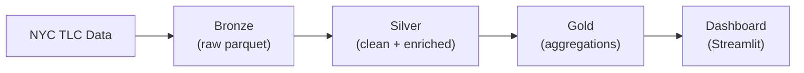

# NYC Taxi Data Lake

[](https://github.com/PedroFlores199/nyc-taxi-lakehouse/actions/workflows/ci.yml)

Data lake con arquitectura medallion (bronze, silver, gold) sobre los datos públicos de viajes de taxi de Nueva York. Procesado con PySpark, orquestado con Airflow y visualizado con Streamlit.

## Arquitectura



## Stack

| Componente | Tecnología |
|---|---|
| Procesamiento | PySpark 3.5 |
| Orquestación | Apache Airflow 2.8 |
| Dashboard | Streamlit + Plotly |
| Base de datos | PostgreSQL 16 |
| Contenedores | Docker Compose |
| CI/CD | GitHub Actions |

## Estructura

```
nyc-taxi-lakehouse/
├── src/
│   ├── ingest/
│   │   └── bronze.py
│   ├── transform/
│   │   ├── silver.py
│   │   └── gold.py
│   ├── quality/
│   │   └── checks.py
│   └── spark_session.py
├── dags/
│   └── taxi_pipeline.py
├── dashboard/
│   └── app.py
├── tests/
│   ├── conftest.py
│   ├── test_silver.py
│   ├── test_gold.py
│   └── test_quality.py
├── docker-compose.yml
├── requirements.txt
├── requirements-dev.txt
└── README.md
```

## Requisitos

- Docker y Docker Compose
- Python 3.11+

## Arranque rápido

### Con Docker

```bash
docker-compose up -d
```

| Servicio | URL | Credenciales |
|---|---|---|
| Airflow | http://localhost:8081 | admin / admin |
| Dashboard | http://localhost:8501 | — |

### Sin Docker

```bash
python -m venv .venv
source .venv/bin/activate
pip install -r requirements.txt
```

Ejecución manual del pipeline:

```bash
python -m src.ingest.bronze --year 2024 --month 1
python -m src.transform.silver --year 2024 --month 1
python -m src.transform.gold
streamlit run dashboard/app.py
```

## Pipeline

### Bronze (ingesta)

Descarga los ficheros Parquet de Yellow Taxi del portal [NYC TLC](https://www.nyc.gov/site/tlc/about/tlc-trip-record-data.page) y los almacena particionados por `year/month`. La ingesta es idempotente: si el fichero ya existe, no se vuelve a descargar.

### Silver (limpieza y enriquecimiento)

Reglas de descarte aplicadas:

| Regla | Condición |
|---|---|
| Distancia inválida | <= 0 o > 100 millas |
| Importe negativo | fare_amount < 0 |
| Pasajeros inválidos | 0 o > 6 |
| Duración imposible | <= 0 o > 360 min |
| Fecha fuera de rango | fuera del mes del fichero |

Columnas calculadas: `duration_minutes`, `avg_speed_mph`, `tip_percentage`, `time_slot`, `day_of_week`, `is_holiday`.

Se genera un informe de rechazo con el conteo de filas descartadas por cada motivo.

### Gold (agregados de negocio)

- Demanda por zona y hora (viajes, importe medio, propina media).
- Top 10 trayectos zona a zona por distrito.
- Tiempo medio entre zonas por franja horaria.
- Ranking mensual con funciones de ventana: las 3 zonas con más demanda por distrito y su variación respecto al mes anterior.
- Detección de anomalías: viajes con tarifa por milla por encima de 3 desviaciones típicas de la media de su ruta.

## Optimizaciones

**Broadcast join** — La tabla de zonas (265 filas) se distribuye con `F.broadcast()` a todos los ejecutores, eliminando el shuffle contra millones de filas de viajes.

**Particionado** — Bronze se particiona por `year/month` para escaneos por rango. Silver se particiona por `pickup_date` para consultas diarias.

**Shuffle partitions** — Configurado a 8 en modo local. El valor por defecto de 200 es excesivo para un solo nodo y genera ficheros pequeños innecesarios.

## Tests

```bash
pip install -r requirements-dev.txt
pytest -v --cov=src
```

Cada regla de limpieza y cada transformación gold tiene su propio test con DataFrames pequeños fabricados a mano. Las sesiones de Spark se comparten a nivel de sesión de pytest para evitar el coste de arranque repetido.

## Decisiones técnicas

**Parquet sobre CSV** — Formato columnar con predicate pushdown y compresión. Reduce el tamaño en disco y el tiempo de lectura un orden de magnitud frente a CSV.

**Funciones puras** — Las transformaciones son funciones `DataFrame -> DataFrame` sin efectos secundarios. La lectura y la escritura se hacen fuera, lo que permite testear cada paso aisladamente.

**Idempotencia** — El pipeline se puede ejecutar varias veces sobre el mismo mes sin duplicar datos ni generar errores.

## Datos

- Fuente: [NYC TLC Trip Record Data](https://www.nyc.gov/site/tlc/about/tlc-trip-record-data.page)
- Volumen: ~3M filas/mes, ~18M para 6 meses
- Formato: Apache Parquet

## Licencia

MIT
