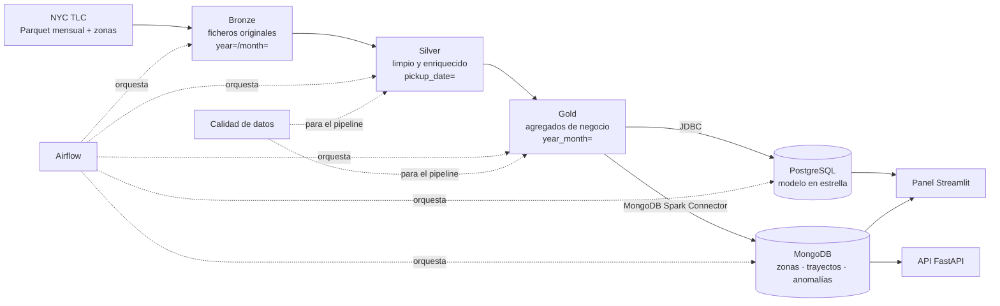
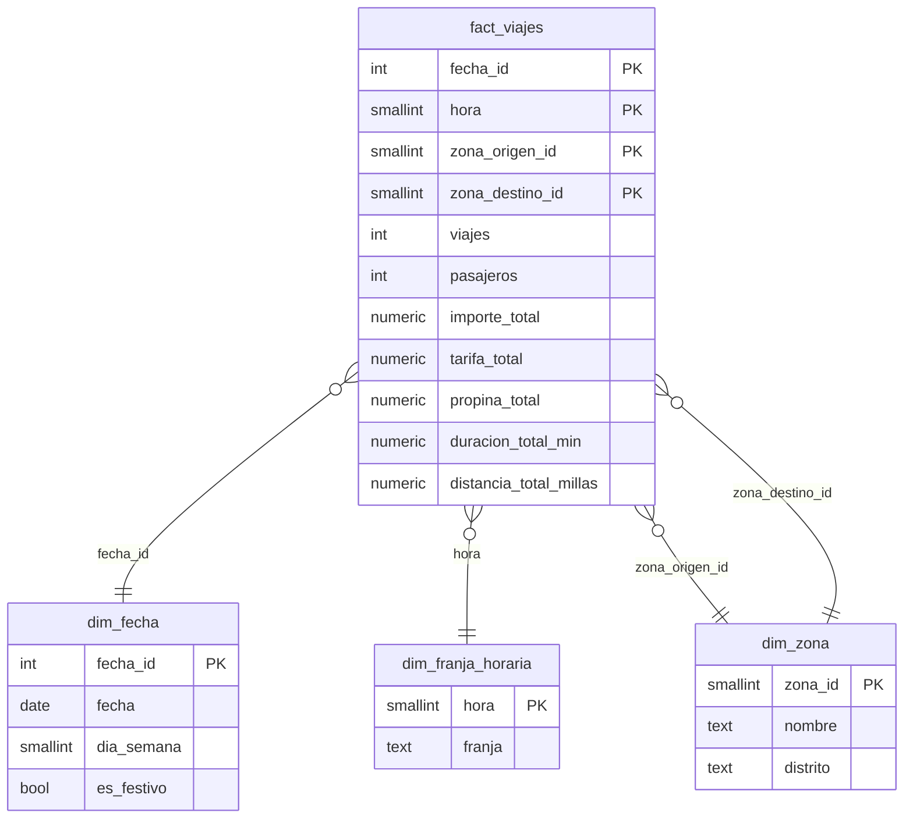

# NYC Taxi Lakehouse

[](https://github.com/PedroFlores199/nyc-taxi-lakehouse/actions/workflows/ci.yml)

Data lake con arquitectura medallion (bronze → silver → gold) sobre los viajes de taxi amarillo de Nueva York. Se procesa con PySpark 3.5 en modo local. Los agregados van a un modelo en estrella en PostgreSQL para informes y a MongoDB para una API de baja latencia. Airflow lo orquesta y la calidad de los datos se comprueba en cada capa.

## Arquitectura



| Pieza | Tecnología |
|---|---|
| Procesamiento | PySpark 3.5 (`local[*]`), Spark MLlib |
| Lake | Parquet (opcional: Delta Lake con `LAKE_FORMAT=delta`) |
| Orquestación | Apache Airflow 2.10 (LocalExecutor) |
| Almacén analítico | PostgreSQL 16 |
| Capa de servicio | MongoDB 7 |
| API | FastAPI |
| Panel | Streamlit + Plotly |
| Infraestructura | Docker Compose, GitHub Actions |

## Puesta en marcha

Requisitos: Docker con al menos 8 GB de memoria asignada.

```bash
cp .env.example .env
docker compose up -d --build
```

En Linux, pon `AIRFLOW_UID=$(id -u)` en `.env` para que Airflow pueda escribir en `./data`.

| Servicio | URL |
|---|---|
| Airflow (usuario y contraseña de `.env`) | http://localhost:8080 |
| API (documentación interactiva) | http://localhost:8000/docs |
| Panel | http://localhost:8501 |
| Spark History Server | http://localhost:18080 |
| PostgreSQL | `localhost:5432`, base `taxi` |
| MongoDB | `localhost:27017`, base `nyc_taxi` |

Spark se ejecuta en modo local (`local[*]`) dentro de las tareas de Airflow; la imagen `docker/airflow/Dockerfile` añade Java 17 y PySpark. Cada job deja su *event log* en `data/spark-events`, y el servicio `spark-history` los muestra con sus etapas, shuffles y planes.

Procesar un mes con el DAG:

```bash
docker compose exec airflow-scheduler airflow dags unpause nyc_taxi_lakehouse
docker compose exec airflow-scheduler airflow dags trigger nyc_taxi_lakehouse --conf '{"mes": "2024-01"}'
```

Sin parámetro, el DAG procesa el último mes publicado por la TLC, que publica con unos dos meses de retraso.

### Sin Docker

Requiere Python 3.11 y Java 17.

```bash
python -m venv .venv && source .venv/bin/activate
pip install -r requirements-dev.txt
python -m src.pipeline todo --desde 2024-01 --hasta 2024-06
```

Cada etapa se puede lanzar por separado: `bronze --desde/--hasta`, `silver --mes`, `gold --mes`, `postgres --mes`, `mongo --mes` y `modelo --mes`. Las conexiones se configuran con variables de entorno (`DATA_PATH`, `MONGO_URI`, `POSTGRES_HOST`…; ver `src/config.py`).

## Estructura

```
nyc-taxi-lakehouse/
├── src/
│   ├── ingest/bronze.py        descarga idempotente de viajes y zonas
│   ├── transform/
│   │   ├── silver.py           reglas de limpieza y columnas derivadas
│   │   ├── gold.py             agregados de negocio
│   │   └── zones.py            shapefile → GeoJSON en WGS84
│   ├── quality/checks.py       expectativas que paran el pipeline
│   ├── load/
│   │   ├── warehouse.py        modelo en estrella en PostgreSQL
│   │   ├── mongo.py            documentos de la capa de servicio
│   │   └── mongo_schema.py     validación e índices
│   ├── ml/                     modelo de duración (MLlib) y su evaluación sin Spark
│   ├── config.py               configuración por variables de entorno
│   ├── domain.py               franjas horarias, meses y días
│   ├── lake.py                 rutas y lectura/escritura de tablas
│   ├── pipeline.py             CLI con todas las etapas
│   └── spark_session.py        única configuración de la sesión de Spark
├── api/                        FastAPI sobre MongoDB
├── dags/taxi_pipeline.py       DAG de Airflow
├── dashboard/                  panel Streamlit
├── mongo/                      índices y JSON Schema de cada colección
├── sql/warehouse.sql           DDL del almacén y vistas de informe
├── benchmarks/                 comparativas y planes de ejecución
├── docs/rendimiento/           resultados generados por benchmarks/
├── docker/                     imagen de Airflow e inicialización de PostgreSQL
├── tests/
└── docker-compose.yml
```

## Pipeline

Todas las transformaciones son funciones puras `DataFrame → DataFrame`. La lectura y la escritura están solo en las funciones `run_*`, así que cada regla se prueba con DataFrames de pocas filas.

### Bronze

`src/ingest/bronze.py` descarga los meses indicados y las dos tablas de zonas sin modificarlas:

```
data/bronze/trips/year=2024/month=01/yellow_tripdata_2024-01.parquet
data/bronze/zones/taxi_zone_lookup.csv
data/bronze/zones/taxi_zones.zip
```

Es idempotente: si el fichero existe, no se vuelve a descargar. Cada descarga se escribe primero en un `.part` y se renombra al terminar. Así, una descarga cortada nunca deja un fichero a medias que la siguiente ejecución dé por bueno.

### Silver

| Regla (por orden de prioridad) | Descarta |
|---|---|
| `claves_nulas` | fecha de recogida o llegada, zona de origen o destino nulas |
| `fecha_fuera_de_mes` | recogida fuera del mes del fichero |
| `duracion_invalida` | duración ≤ 0 o > 6 h |
| `distancia_invalida` | distancia nula, ≤ 0 o > 100 millas |
| `importe_negativo` | tarifa o importe total negativos o nulos |
| `pasajeros_invalidos` | 0, más de 6 o desconocido |
| `duplicado` | segunda aparición del mismo viaje |

Columnas calculadas: `duration_minutes`, `avg_speed_mph`, `tip_pct`, `time_slot`, `day_of_week` (ISO, 1 = lunes), `is_holiday` (festivos federales y de Nueva York) y, mediante un broadcast join, zona y distrito de origen y destino. Silver se guarda particionado por `pickup_date`, y por cada mes se escribe un informe de descartes. Este es el de enero de 2024:

```json
{
  "mes": "2024-01",
  "filas_leidas": 2964624,
  "filas_validas": 2722242,
  "filas_descartadas": 242382,
  "motivos": {
    "pasajeros_invalidos": 145937,
    "distancia_invalida": 59650,
    "importe_negativo": 34135,
    "duracion_invalida": 2642,
    "fecha_fuera_de_mes": 18
  }
}
```

El shapefile de zonas está en EPSG:2263 (pies, plano estatal de Long Island). `src/transform/zones.py` lo reproyecta a WGS84 y une las partes de una misma zona. También repara geometrías no válidas, ajusta la precisión a 6 decimales y normaliza todo a `MultiPolygon`, que es lo que exige un índice `2dsphere`.

### Gold

| Tabla | Grano |
|---|---|
| `demand_zone_hour` | mes, fecha, hora y zona de origen: viajes, importe medio, propina media |
| `top_routes_borough` | top 10 de trayectos zona → zona por distrito y mes |
| `travel_time_zones` | origen, destino y franja: duración, importe y distancia medios |
| `monthly_zone_ranking` | las 3 zonas con más demanda de cada distrito y mes, con su variación respecto al mes anterior |
| `anomalies` | viajes cuyo importe por milla supera la media de su trayecto en más de 3 desviaciones típicas |
| `trips_aggregated` | fecha, hora, origen y destino: medidas aditivas para el almacén |

Detalles que importan:

- **Variación mensual.** Se calcula con `lag()` antes de filtrar el top 3, y solo si el mes anterior es el calendario inmediatamente anterior. Si una zona no tuvo viajes un mes, la variación queda nula en vez de compararse con un mes antiguo.
- **Anomalías.** Solo se evalúan trayectos con al menos 30 viajes, para que la desviación típica sea fiable. La media y la desviación se calculan con funciones de ventana sobre la ruta: un único shuffle, frente a los dos de un `groupBy` seguido de un join.
- **Particionado.** Gold se particiona por `year_month` con *dynamic partition overwrite*: reprocesar un mes sustituye solo su partición.

## Calidad de datos

`src/quality/checks.py` define expectativas (sin nulos en claves, rangos válidos, tabla no vacía y unicidad de claves). Todas las de rango y nulos se evalúan en **una sola pasada** con un `agg`. Se ejecutan antes de escribir: si alguna falla, se lanza `DataQualityError`, la tarea de Airflow falla y no se escribe nada en la capa siguiente.

```
[silver.trips] passenger_count en [1, 6]: OK
[silver.trips] sin duplicados en trip_id: OK
```

## Almacén analítico (PostgreSQL)



Los hechos guardan solo medidas aditivas (sumas y recuentos): cualquier media se obtiene dividiendo sumas, y es correcta a cualquier nivel de agregación. Las vistas `v_demanda_zona_hora` y `v_trayectos` resuelven los informes habituales.

La carga es idempotente y atómica por mes. Spark escribe el mes por JDBC en `stg_fact_viajes`, y después, en una única transacción, se borra el mes de `fact_viajes` y se inserta desde staging. Con enero de 2024 quedan 1.033.972 filas de hechos que suman 2.722.242 viajes, exactamente las filas válidas de silver.

## Capa de servicio (MongoDB)

| Colección | Documento | Índices |
|---|---|---|
| `zonas` | una zona: polígono, centroide, demanda por día y hora, resumen mensual y 5 destinos más frecuentes | `2dsphere` en `geometria` y en `centroide`, `distrito` |
| `trayectos` | una pareja origen–destino: duración, importe y distancia medios en total y por franja | compuesto único `{origen, destino}` |
| `anomalias` | un viaje sospechoso con todos sus datos | TTL de 90 días en `cargado_en`, `{fecha_recogida, _id}`, `{zona_origen_id, mes}` |
| `modelos` | coeficientes y métricas del modelo de duración | — |

Cada colección tiene un validador `$jsonSchema` (`mongo/validators/`) en modo estricto. `src/load/mongo_schema.py` aplica validadores e índices de forma idempotente antes de cada carga.

**Por qué documentos anidados en `zonas`.** La app pregunta siempre lo mismo: «dame todo lo de esta zona». Anidar la demanda (como mucho 7 × 24 = 168 entradas), el resumen mensual y los 5 destinos deja documentos de unos 20 KB de media (el mayor, con el polígono más complejo, ocupa 258 KB, lejos del límite de 16 MB). Una sola lectura por `_id` devuelve todo, sin joins y con una latencia submilisegundo (ver la comparativa). Se anida porque los datos se leen siempre junto a la zona, están acotados y cambian a la vez, en cada carga. Los viajes anómalos, en cambio, crecen sin límite, se consultan por fechas y se paginan, así que van en su propia colección.

**Carga sin duplicados.** Se hace con el MongoDB Spark Connector en modo `replace` con `upsertDocument`, usando `_id` como clave:

- `zonas` y `trayectos` se reconstruyen a partir de todos los meses de gold. Después se eliminan los documentos cuyo `actualizado_en` es anterior a la carga.
- En `anomalias` se borra el mes antes de escribirlo. Como el `_id` es un hash determinista del viaje, reprocesar un mes deja exactamente los mismos documentos. Comprobado: dos cargas seguidas dejan 24.942 anomalías con 24.942 `_id` distintos.

**TTL.** El índice TTL va sobre `cargado_en` y no sobre la fecha del viaje. Los datos de 2024 tienen más de 90 días, así que con un TTL sobre la fecha del viaje se borrarían nada más cargarse.

**Aggregation pipeline.** `GET /informes/propina-distrito` calcula la propina media y el número de viajes anómalos por distrito y mes. Usa `$match`, `$unwind` del resumen mensual, `$lookup` con *pipeline* sobre `anomalias` (que aprovecha el índice `{zona_origen_id, mes}`), `$group` y `$project` (`api/routers/informes.py`).

### explain() con y sin índice

Generado con `python -m benchmarks.mongo_explain` sobre los datos de enero de 2024:

| Consulta | Índice | Plan | Docs examinados | Servidor (ms) | Cliente, mediana (ms) |
|---|---|---|---|---|---|
| trayecto `{origen, destino}` | ninguno | COLLSCAN | 23.534 | 6 | 5,79 |
| trayecto `{origen, destino}` | `origen_destino` | IXSCAN → FETCH | 1 | 0 | 0,35 |
| anomalías de un día ordenadas | ninguno | COLLSCAN → SORT | 24.942 | 7 | 13,09 |
| anomalías de un día ordenadas | `fecha_recogida` | IXSCAN → FETCH | 1.155 | 2 | 5,51 |

## API

| Endpoint | Descripción |
|---|---|
| `GET /zonas/cerca?lat=&lon=&radio_m=&limite=` | zona en la que estás (`$geoIntersects` sobre el polígono) y zonas de alrededor (`$near` sobre el centroide) |
| `GET /trayecto?origen=&destino=&hora=` | duración e importe estimados para la franja de esa hora; si no hay datos de esa franja, usa la media del trayecto |
| `GET /zonas/{id}/demanda?dia_semana=` | demanda de la zona por hora y por día y hora |
| `GET /anomalias?desde=&hasta=&pagina=&tamano=` | viajes sospechosos paginados |
| `GET /informes/propina-distrito?desde=&hasta=` | aggregation pipeline por distrito y mes |
| `GET /prediccion/duracion?origen=&destino=&hora=` | duración estimada por el modelo de Spark MLlib |
| `GET /salud` | comprobación de vida |

Respuestas reales con enero de 2024:

```
GET /zonas/cerca?lat=40.758&lon=-73.9855&radio_m=1500&limite=3
→ zona_actual: 230 Times Sq/Theatre District · cercanas: 100 Garment District (570 m), 48 Clinton East…

GET /trayecto?origen=132&destino=230&hora=17
→ JFK Airport → Times Sq/Theatre District, franja punta_tarde:
  52,7 min y 96,18 $ de media (1.915 viajes observados)
```

## Panel

Streamlit lee la demanda y los trayectos del modelo en estrella, y las anomalías y los polígonos de MongoDB:

- Mapa de calor de viajes medios por día de la semana y hora.
- Top 10 de trayectos con su duración e importe medios.
- Mapa coroplético con el número de viajes sospechosos por zona de origen y la tabla de los casos más extremos.

Se filtra por fechas y distritos.

## Optimización de Spark

- **Broadcast join con las zonas.** La tabla de zonas tiene 265 filas (unos 15 KB) y se cruza con millones de viajes. Con `F.broadcast` se envía una copia a cada ejecutor y el lado grande no se mueve: desaparecen los dos shuffles y las dos ordenaciones de un *sort-merge join*. El *hint* explícito garantiza el broadcast aunque Spark no tenga estadísticas del lado pequeño. Pasa, por ejemplo, cuando ese lado viene de un CSV o de una subconsulta. Hay un test que comprueba que el plan contiene `BroadcastHashJoin`.
- **Particionado.**
  - Bronze, por `year/month`: es la unidad de publicación de la TLC y hace trivial la idempotencia.
  - Silver, por `pickup_date`: las consultas filtran por rangos de fechas y Spark solo abre las carpetas necesarias (*partition pruning*).
  - Gold, por `year_month`: es la unidad de reproceso.
- **`repartition("pickup_date")` antes de escribir silver.** Cada fecha queda en un único fichero de unos 3 MB. Sin él, cada una de las 8 tareas escribiría un fichero en cada una de las 31 carpetas: 248 ficheros pequeños por mes. Además, `sortWithinPartitions("pickup_datetime")` mejora las estadísticas min/max de Parquet para los filtros por hora.
- **`coalesce(1)` en las tablas gold pequeñas** (top de trayectos, ranking y anomalías). Junta particiones sin shuffle y evita decenas de ficheros de pocos KB.
- **`spark.sql.shuffle.partitions = 8`** en modo local: con el valor por defecto de 200, cada agregación crearía 200 tareas casi vacías.
- **`persist`** del DataFrame de silver mientras se calculan las cinco tablas gold, para no leer y filtrar cinco veces lo mismo.

### Plan de ejecución antes y después

Consulta: viajes e importe medio por distrito, zona de servicio y hora de la semana del 15 al 21 de enero. Ambas versiones devuelven las mismas filas. La salida completa está en [docs/rendimiento/spark_explain.md](docs/rendimiento/spark_explain.md) (`python -m benchmarks.spark_explain`).

Antes (sin broadcast, filtro sobre una columna calculada):

```
+- SortMergeJoin Inner
   :- Sort
   :  +- ShuffleQueryStage  Statistics(sizeInBytes=18.8 MiB, rowCount=6.17E+5)
   :     +- Exchange hashpartitioning(pickup_location_id, 8)
   :        +- Scan parquet  PartitionFilters: []  (lee las 31 carpetas)
   +- Sort
      +- ShuffleQueryStage  Statistics(rowCount=265)
         +- Exchange hashpartitioning(LocationID, 8)
            +- Scan csv
```

Después (broadcast, filtro sobre la columna de partición y proyección mínima):

```
+- BroadcastHashJoin Inner BuildRight
   :- Project [pickup_location_id, pickup_hour, total_amount]
   :  +- Scan parquet  PartitionFilters: [pickup_date >= 2024-01-15, pickup_date <= 2024-01-21]
   +- BroadcastQueryStage  Statistics(rowCount=265)
      +- BroadcastExchange
         +- Scan csv
```

| Versión | Mediana de 10 ejecuciones |
|---|---|
| Antes | 23,6 ms |
| Después | 18,6 ms |

El optimizador de Spark ya traduce el filtro `to_date(pickup_datetime) BETWEEN …` a un rango sobre `pickup_datetime` y lo empuja a Parquet. Por eso, con un único mes en local, la diferencia de tiempo es pequeña. Lo que cambia es el trabajo:

- Antes, 617.000 filas (18,8 MiB) se reparten por la red para el join y se abren los 31 ficheros.
- Después, solo viajan 265 filas y se abren 7 ficheros.

Con un clúster y meses de historia, ese shuffle es lo que domina el coste.

## Extras

### pandas frente a Spark

Mismo trabajo en las dos herramientas: leer los Parquet de bronze, aplicar las reglas de limpieza, quitar duplicados, unir con las zonas y agregar la demanda por zona y hora (`python -m benchmarks.pandas_vs_spark`). Las dos devuelven exactamente los mismos grupos. Se midió en un portátil de 12 núcleos, con Spark en `local[*]`.

| Meses | Filas leídas | pandas (s) | Spark (s) |
|---|---|---|---|
| 1 | 2.964.624 | 0,9 | 1,3 |
| 3 | 9.554.778 | 3,2 | 3,3 |
| 6 | 20.332.093 | 6,7 | 6,1 |


Con un mes, pandas gana: Spark paga la planificación y la coordinación de tareas. Hacia los 3 meses empatan, y con 6 Spark ya es más rápido, porque reparte la lectura, el filtrado y la deduplicación entre todos los núcleos. La diferencia de verdad aparece con más volumen. pandas necesita que todo quepa en la memoria de un proceso y no tiene más margen que una máquina más grande. Spark trabaja por particiones, vuelca a disco cuando no cabe y el mismo código escala a un clúster sin cambios.

### La misma consulta en PostgreSQL y en MongoDB

Demanda de una zona por hora (`python -m benchmarks.postgres_vs_mongo`, 200 ejecuciones por zona):

| Zona | PostgreSQL mediana (ms) | PostgreSQL p95 (ms) | MongoDB mediana (ms) | MongoDB p95 (ms) |
|---|---|---|---|---|
| 132 JFK Airport | 15,02 | 17,21 | 0,53 | 1,28 |
| 161 Midtown Center | 9,17 | 10,85 | 0,45 | 0,76 |
| 230 Times Square | 9,15 | 11,20 | 0,45 | 0,82 |
| 236 Upper East Side North | 7,86 | 9,11 | 0,45 | 1,00 |
| 61 Crown Heights North | 0,50 | 0,70 | 0,41 | 0,89 |

En PostgreSQL la consulta agrega en cada petición las filas de hechos de la zona: miles para las zonas con mucho tráfico. El coste crece con el volumen y con el rango de fechas, pero se puede preguntar cualquier cosa (otra franja, otro distrito, otro periodo) sin rediseñar nada. En MongoDB la respuesta ya está precalculada dentro del documento de la zona: el tiempo es constante (≈ 0,5 ms) y no depende de cuántos viajes tenga, pero solo responde a las preguntas para las que se diseñó el documento.

**Conclusión:** SQL para análisis e informes ad hoc, y MongoDB como vista materializada para la app, con lecturas por clave y latencia predecible. Por eso el pipeline carga los dos desde la misma capa gold.

### Delta Lake y time travel

Con `LAKE_FORMAT=delta`, silver y gold se guardan como tablas Delta. La escritura usa la misma sobrescritura dinámica por partición y la lectura admite `versionAsOf` y `timestampAsOf` (`src/lake.py`). `python -m benchmarks.delta_time_travel` carga enero (versión 0), carga febrero (versión 1) y consulta la tabla tal como estaba antes de cargar febrero:

| Lectura de `silver/trips` | Filas por mes |
|---|---|
| Última versión | 2024-01: 2.722.242 · 2024-02: 2.718.160 |
| `option("versionAsOf", 0)` | 2024-01: 2.722.242 |
| `option("timestampAsOf", <fecha del primer commit>)` | 2024-01: 2.722.242 |

Así se puede responder qué decía un informe ayer, auditar una corrección o deshacer una carga errónea con `RESTORE`.

### Modelo de duración con Spark MLlib

`src/ml/duration_model.py` entrena una regresión lineal con la distancia, el fin de semana, la franja horaria y los distritos de origen y destino (*one-hot encoding*). Con el 20 % de enero de 2024 (435.959 filas de entrenamiento), sobre el conjunto de test:

| MAE | RMSE | R² |
|---|---|---|
| 4,52 min | 7,17 min | 0,649 |

Los coeficientes se exportan a la colección `modelos`, y la API calcula la predicción sin necesitar Spark (`GET /prediccion/duracion`). Un test comprueba que la predicción exportada coincide con la de Spark para las mismas filas.

## Tests y CI

```bash
pip install -r requirements-dev.txt
pytest
```

- **Silver:** un test por cada regla de limpieza, valores límite, columnas derivadas, franjas, festivos, plan con broadcast y extremo a extremo.
- **Gold:** demanda, top por distrito, tiempos por franja, ranking con variación mensual (incluido un mes sin datos) y anomalías.
- **Calidad:** cada expectativa pasa con datos limpios y para el pipeline con datos sucios.
- **Bronze:** idempotencia y descargas cortadas, con un descargador falso.
- **Zonas:** reproyección de un shapefile fabricado y reparación de geometrías.
- **Carga:** dimensiones, documentos de MongoDB y recarga de un mes sin duplicados en PostgreSQL.
- **API:** con `mongomock` para los endpoints normales y con un MongoDB real para `$geoIntersects`, `$near` y el aggregation pipeline.
- **Modelo:** paridad entre la predicción de Spark y la exportada.

Las pruebas de integración se activan con `MONGO_TEST_URI` y `POSTGRES_TEST_DSN`. En local, sin esas variables, se omiten. En GitHub Actions se ejecutan siempre, contra contenedores de servicio de MongoDB y PostgreSQL, junto con `ruff check` y `ruff format --check`.

## Preguntas de entrevista

**¿Qué es un shuffle y cómo lo has reducido?** Es redistribuir filas entre particiones por una clave. Implica serializar, escribir a disco y mover datos por la red, y es lo más caro de un job de Spark. Lo he reducido de cuatro formas:

- Broadcast join con las zonas, en lugar de un *sort-merge join*.
- Funciones de ventana para las estadísticas por trayecto, en lugar de `groupBy` más join.
- `persist` de silver para no repetir lecturas.
- 8 particiones de shuffle en local.

**¿Por qué Parquet y no CSV? ¿Por qué particionas por fecha?** Parquet es columnar, va comprimido y guarda tipos y estadísticas por bloque. Spark lee solo las columnas que necesita y se salta bloques enteros con los filtros (*predicate pushdown*). Enero de 2024 ocupa 47,6 MB en Parquet frente a 296 MB en CSV, y no hay que inferir el esquema. Particiono por fecha porque casi todas las consultas filtran por un rango de días, y porque así reprocesar un periodo solo reescribe sus particiones.

**¿Por qué MongoDB para la API y SQL para los informes? ¿No bastaba con una?** Son patrones de acceso opuestos. Los informes combinan dimensiones de forma imprevisible y necesitan joins, agregaciones y ventanas: ahí brilla el modelo en estrella. La app hace siempre las mismas lecturas por clave o por posición, con latencia baja y estable, y necesita consultas geoespaciales: ahí brilla un documento precalculado con índices `2dsphere`. Con una sola base habría que renunciar a una de las dos cosas. La comparativa de arriba lo cuantifica.

**¿Cuándo anidarías datos en un documento y cuándo harías otra colección?** Anido cuando se leen siempre junto al padre, su tamaño está acotado y se actualizan a la vez; por ejemplo, la demanda o los destinos de una zona. Uso otra colección cuando crecen sin límite (el máximo de un documento son 16 MB), se consultan por sí solos o se actualizan con otra frecuencia, como las anomalías.

**¿Qué hace un índice `2dsphere`? ¿Y uno TTL?** Un `2dsphere` indexa geometrías GeoJSON sobre la esfera terrestre. Permite `$geoIntersects` («¿en qué zona cae este punto?»), `$near` y `$geoWithin` sin recorrer toda la colección. Un TTL hace que MongoDB borre automáticamente los documentos cuyo campo de fecha es más antiguo que `expireAfterSeconds`, mediante un proceso en segundo plano que se ejecuta cada minuto.

**¿Qué pasa si el pipeline se ejecuta dos veces el mismo día?** Nada distinto de ejecutarlo una vez:

- Bronze no vuelve a descargar.
- Silver y gold sobrescriben solo las particiones de ese mes.
- PostgreSQL sustituye el mes en una transacción.
- MongoDB reemplaza los documentos por `_id` y vuelve a escribir las anomalías del mes.

Comprobado con enero de 2024: tras dos ejecuciones seguidas siguen las mismas 1.033.972 filas de hechos, las mismas 265 zonas, los mismos 23.534 trayectos y las mismas 24.942 anomalías. Además, el DAG tiene `max_active_runs=1` para que dos ejecuciones no escriban a la vez.

## Licencia

MIT
