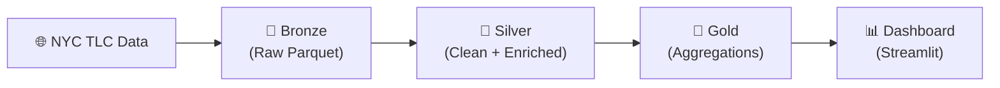

# 🚕 NYC Taxi Data Lake

[](https://github.com/PedroFlores199/nyc-taxi-lakehouse/actions/workflows/ci.yml)

Data lake con **arquitectura medallion** (bronze → silver → gold) para analizar los viajes de taxi de Nueva York, procesado con **PySpark** y orquestado con **Airflow**.

---

## 🏗️ Arquitectura



---

## 🛠️ Stack Tecnológico

| Componente | Tecnología |
|---|---|
| Procesamiento | PySpark 3.5 |
| Orquestación | Apache Airflow 2.8 |
| Dashboard | Streamlit + Plotly |
| Base de datos | PostgreSQL 16 |
| Contenedores | Docker Compose |
| CI/CD | GitHub Actions |
| Calidad de datos | Great Expectations |

---

## 📁 Estructura del Proyecto

```
nyc-taxi-lakehouse/
├── dags/
│   └── taxi_pipeline_dag.py
├── dashboard/
│   └── app.py
├── data/
│   ├── bronze/
│   ├── silver/
│   └── gold/
├── src/
│   ├── __init__.py
│   ├── ingest/
│   │   ├── __init__.py
│   │   └── bronze.py
│   ├── transform/
│   │   ├── __init__.py
│   │   ├── silver.py
│   │   └── gold.py
│   └── utils/
│       ├── __init__.py
│       └── spark_session.py
├── tests/
│   ├── conftest.py
│   ├── test_bronze.py
│   ├── test_silver.py
│   └── test_gold.py
├── docker-compose.yml
├── Dockerfile
├── Makefile
├── requirements.txt
├── requirements-dev.txt
└── README.md
```

---

## ✅ Requisitos Previos

- **Docker** y **Docker Compose**
- **Python 3.11+**
- **Make** (opcional)

---

## 🚀 Arranque Rápido

### Con Docker (recomendado)

```bash
docker-compose up -d
```

| Servicio | URL | Credenciales |
|---|---|---|
| Airflow | [localhost:8081](http://localhost:8081) | `admin` / `admin` |
| Dashboard | [localhost:8501](http://localhost:8501) | — |

### Sin Docker

```bash
python -m venv .venv
source .venv/bin/activate
pip install -r requirements.txt
```

Ejecutar el pipeline manualmente:

```bash
# 1. Ingestar datos (capa bronze)
python -m src.ingest.bronze --year 2024 --month 1

# 2. Limpiar y enriquecer (capa silver)
python -m src.transform.silver --year 2024 --month 1

# 3. Generar agregados de negocio (capa gold)
python -m src.transform.gold

# 4. Lanzar el dashboard
streamlit run dashboard/app.py
```

---

## 🔄 Pipeline

### 🥉 Bronze (Ingesta)

- Descarga los datos de **Yellow Taxi Trip** del portal [NYC TLC](https://www.nyc.gov/site/tlc/about/tlc-trip-record-data.page) en formato Parquet.
- **Idempotente**: si el fichero del mes ya existe, se omite la descarga.
- Particionado por `year/month` para consultas eficientes por rango.

### 🥈 Silver (Limpieza y Enriquecimiento)

Se aplican las siguientes reglas de filtrado para descartar registros inválidos:

| Regla | Condición de descarte |
|---|---|
| Distancia inválida | ≤ 0 o > 100 millas |
| Importe negativo | `fare_amount` < 0 |
| Pasajeros inválidos | = 0 o > 6 |
| Duración imposible | ≤ 0 o > 360 minutos |
| Fecha fuera de rango | Fuera del mes del fichero |

**Columnas calculadas** que se añaden en esta capa:

- `duration_minutes` — duración del viaje en minutos
- `avg_speed_mph` — velocidad media en millas por hora
- `tip_percentage` — porcentaje de propina sobre la tarifa
- `time_slot` — franja horaria (madrugada, mañana, tarde, noche)
- `day_of_week` — día de la semana
- `is_holiday` — indicador de día festivo (EE.UU.)

### 🥇 Gold (Agregados de Negocio)

- **Demanda por zona y hora**: volumen de viajes por zona de recogida, hora y día de la semana.
- **Top 10 trayectos por distrito**: rutas más frecuentes agrupadas por borough de origen y destino.
- **Tiempo medio entre zonas**: duración promedio del viaje por par de zonas y franja horaria.
- **Ranking mensual**: clasificación de zonas con funciones de ventana (`ROW_NUMBER`, `RANK`).
- **Detección de anomalías**: viajes con tarifa o distancia superior a 3 desviaciones estándar (> 3σ).

---

## ⚡ Optimizaciones

### Broadcast Join

La tabla de zonas (**265 filas**, ~10 KB) se distribuye a todos los ejecutores mediante `broadcast()`, evitando un costoso shuffle join contra millones de filas de viajes.

### Particionado

| Capa | Estrategia | Beneficio |
|---|---|---|
| Bronze | Por `year/month` | Escaneos eficientes por rango temporal |
| Silver | Por `pickup_date` | Consultas diarias rápidas |

### Ejecución Optimizada

`spark.sql.shuffle.partitions` configurado a **8** en modo local (el valor por defecto de 200 es excesivo para un solo nodo).

---

## 🧪 Tests

```bash
pip install -r requirements-dev.txt
pytest -v --cov=src
```

Los tests utilizan sesiones de Spark en modo local con datos sintéticos generados con fixtures de `pytest`.

---

## 💡 Decisiones Técnicas

| Decisión | Justificación |
|---|---|
| **Parquet vs CSV** | Parquet es columnar, soporta predicate pushdown y compresión. Resulta ~10× más pequeño y rápido que CSV. |
| **Funciones puras** | Todas las transformaciones son funciones `DataFrame → DataFrame`, separadas del I/O, facilitando el testing unitario. |
| **Idempotencia** | El pipeline puede ejecutarse múltiples veces sin efectos secundarios ni duplicación de datos. |
| **Broadcast join** | La tabla de zonas (265 filas, ~10 KB) se distribuye con broadcast para evitar un shuffle join contra millones de filas. |

---

## 📊 Datos

| Propiedad | Valor |
|---|---|
| **Fuente** | [NYC TLC Trip Record Data](https://www.nyc.gov/site/tlc/about/tlc-trip-record-data.page) |
| **Volumen** | ~3M filas/mes, ~18M para 6 meses |
| **Formato** | Apache Parquet |

---

## 📄 Licencia

Este proyecto está licenciado bajo la [Licencia MIT](LICENSE).
