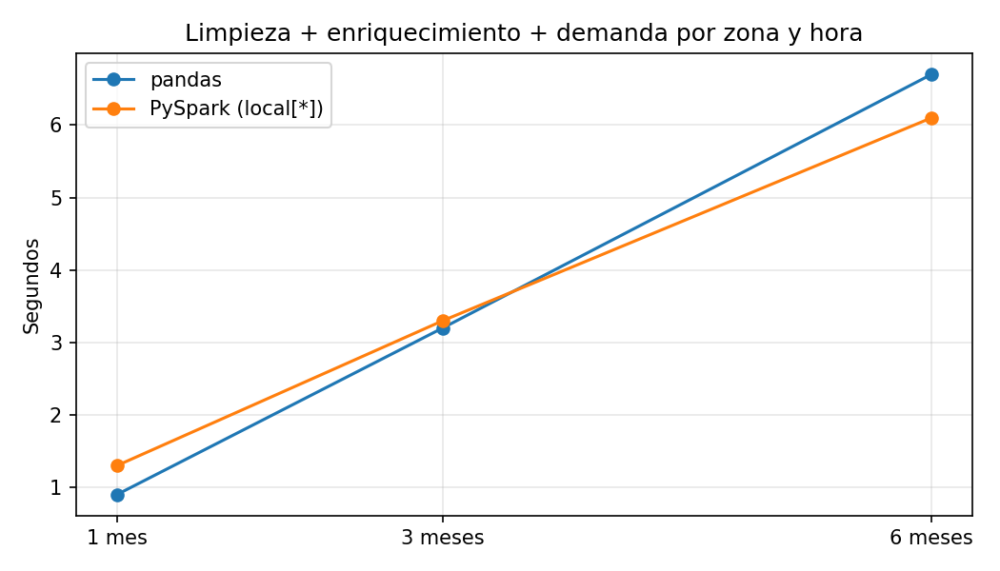

# pandas frente a Spark

Mismo trabajo en las dos herramientas: leer los Parquet de bronze, aplicar las reglas de limpieza,
quitar duplicados, unir con las zonas y agregar la demanda por zona y hora.

| Meses | Filas leídas | pandas (s) | Spark (s) |
|---|---|---|---|
| 1 | 2.964.624 | 0.9 | 1.3 |
| 3 | 9.554.778 | 3.2 | 3.3 |
| 6 | 20.332.093 | 6.7 | 6.1 |

